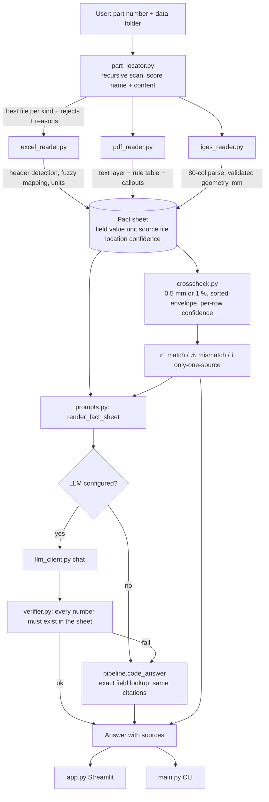
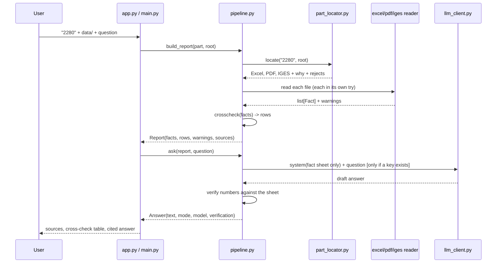

# Technical document - LLM-based CNC part analysis (SPEC'26)

Written so a student can explain every part of it in an interview. Nothing here is
aspirational: each claim names the file that implements it and, where it matters, the
test that pins it.

---

## 1. The one design decision everything else follows from

**Code extracts, the language model only talks.**

A number that comes out of a PDF through an LLM is unverifiable - you cannot tell
whether the model read `Ø 8` or remembered a plausible 8. So every fact in this system
is produced by a deterministic reader, gets a location ("`'Manufacturing_Record'!F2`",
"page 1, title block", "IGES entity #1 (type 502)") and a confidence, and the model is
only ever handed that table of facts. If the model then writes a number that is not in
the table, `src/verifier.py` rejects the answer and the deterministic answer is shown
instead.

The model is used in exactly three places (`src/prompts.py`, `src/llm_client.py`):

| Use | What it sees | What it may return | If it misbehaves |
|---|---|---|---|
| Header mapping | the column headings + up to 3 sample cells | a rename `{heading: canonical_field}` | an unknown field name is dropped; the original heading is kept as `raw:` |
| Scanned drawings | the rendered page as an image | the text it can read | facts are labelled `llm-vision` and the table says so |
| Phrasing an answer | the fact sheet + the cross-check rows + the question | prose with citations | a number not in the sheet -> answer rejected, code answers |

It is never asked for a measurement, a material, or a guess about what is missing.

---

## 2. Architecture





---

## 3. Data model (`src/fact.py`)

```python
Fact(field, value, unit, source_type, source_file, location, confidence, note)
```

`field` is a canonical name from `src/schema.py` (`outer_diameter`, `surface_finish`,
`cad_units`, ...), so "OD (mm)", "DIA_OUT" and "Aussendurchmesser" all become the same
key and can be compared. A column that maps to nothing is stored as `raw:<heading>` so
the information survives and is still citable.

Confidence is an ordered ladder, and it is the reason the app can be trusted out loud:

```
code-high  >  code-medium  >  code-low  >  llm-vision  >  inferred
read from a   number parsed,   units or      pixels,       best guess
labelled cell  unit inferred    entity type   (OCR sits      from weak evidence
                said so         unmatched     here)
```

`code-low` is used, for example, when a PDF has no declared units, and a cross-check row
takes the **worst** confidence of the sources it compares - a row built from one
`llm-vision` value is `llm-vision`, not `code-high`.

---

## 4. Reading each format

### 4.1 Excel (`src/excel_reader.py`)

1. Every sheet is examined separately; a sheet with no detectable header row is reported
   and skipped as prose (our real record has a free-text "Notes" sheet - it warns, it
   does not invent facts).
2. **Header row detection**: the row whose cells look like labels and whose next rows look
   like data, anywhere from row 1 down. The generated corpus plants one at row 3/4.
3. **Heading -> field** (`schema.match_header`): accents and case are folded, a unit is
   stripped out of the heading first, then synonym list, then fuzzy similarity. Three
   guards keep it honest on unseen sheets:
   - a heading that carries a unit prefers a field of that kind (`id_mm` is the bore, not
     the part number);
   - short ambiguous headings (`id`, `no`, `ref`, `item`) must match **exactly**;
   - `OWNER_WORDS` stops "operator name" from becoming the part name.
4. **Cell typing** (`src/units.py`): one number parser shared by cells and prose - it
   reads `1,234.5`, the European `1.234,5`, `4,3`, `3 1/2`, exponents, and refuses
   letter-led codes (`M5`, `A1`, `ISO`) as quantities. Lengths are converted to mm, times
   to minutes, Ra to um, and the conversion is written into `note` so the UI can show it.
5. **Rows -> parts**: a workbook with one row per part is filtered by the part number;
   the same reader answers a one-file-per-part layout.
6. `.csv` (any dialect), `.xlsx/.xlsm`; `.xls` needs `xlrd` and degrades to a warning.

### 4.2 PDF (`src/pdf_reader.py`)

Text is extracted **with coordinates** (PyMuPDF, pdfplumber as a fallback), grouped into
lines, then:

- a label finds its value to the right on the same line, or below it (both real layouts);
- a declarative `_RULES` table reads callouts in order of specificity, and a rule *claims
  the span it consumed*, so no number is counted twice - `4 X DIA 8 THRU` yields a hole
  diameter of 8 and a quantity of 4, not a stray 4 mm dimension;
- guards against the mistakes a generic reader makes: `842 x 595` is the sheet size, not a
  length; `SCALE 14:1` is declared as a scale and never as a dimension; a date is not a
  size; `ISO 2768-m` is a tolerance standard whose digits are not measurements, while a
  bare `ISO 1874` is treated as a material spec unless the line says "tolerance"; `M5`/`M6`
  are thread designations;
- surface finish (`Ra 1.6`, `N6` in finish context), general notes, revision, units and
  the title block all become facts, each located to a page and a region;
- **scanned pages**: a page whose text layer is thinner than `SCAN_CHARS_PER_PAGE`
  characters is rendered at 200 dpi, OCR is tried if `pytesseract` and Pillow exist,
  otherwise a vision model transcribes it, and every fact from that route carries
  `llm-vision` and says so. If neither is available the file reports a warning - it does
  not pretend.
- text that reads like an instruction ("ignore previous instructions...") is stored
  verbatim as a `general_note` with a note saying it is data, and none of that line is
  parsed as a dimension.

### 4.3 IGES (`src/iges_reader.py`)

A purpose-written 80-column parser: the four sections, the `D`/`P` continuation letters,
the per-line parameter data, and the Global section split with the `nH` field separators
taken from the file itself (a `4HINCH` literal is read as a literal, not as a count).

- units come from Global (`UNIT`/`MDM`) and the factor to mm is applied in code, so an
  inch model is reported in mm and the declared unit is kept as its own fact
  (`cad_units = INCH`) for the cross-check to compare;
- entity counts, author, system and post-processor come from the Directory;
- geometry is decoded for the types whose parameter layout the parser can **validate**
  (circle 100, line 110, plane 126, right circular cylinder 502, torus 122, B-spline
  surfaces 128/126 by control points); a count mismatch means the entity is skipped,
  recorded in `warnings`, and *not* used for the bounding box;
- hole candidates are counted from circles/ cylinders, reported as candidates with
  `code-medium`, never as "there are 4 drilled holes";
- the envelope is reported **sorted** (largest last) because exporters reorder axes;
- if nothing validates, there is no envelope fact at all. Refusing is a feature: our own
  real `2280.igs` is a free-form B-spline export (42 entities, 19 of them not matching
  their documented parameter layout), and the honest output is "geometry is stored in
  entities this parser cannot validate, so no bounding box or size is reported" rather
  than a number.

---

## 5. Discovery (`src/part_locator.py`)

Recursive walk, skipping `~$` lock files and hidden directories. A candidate is scored
by name and by content:

- name: `2280.igs`, `2280_drawing.pdf`, `part-2280.iges`, `3004  rev C.pdf`, `002280.igs`
  and a folder called `2280` all identify the part. The identity test uses whole digit
  runs, so `12280.igs` and `report-v22801.pdf` are **rejected** - they are different
  numbers that contain ours.
- content: for a workbook a cell must **equal** the part number (a remark that mentions
  "see notes for 4412" does not make that file belong to 4412); for other kinds a
  word-boundary hit in the extracted snippet adds score, capped, so a file that repeats
  the number 500 times is not 500x more certain.
- a query whose digits carry fewer than three significant characters (`0`, `00`, `7`) is
  treated as a non-search: lone zeros occur in every tolerance table, so such a query is
  only answered by files that **name** the number. It reports "not found" rather than
  pairing one part's workbook with another part's drawing. Leading zeros on a real number
  still work (`03004` and `003004` resolve exactly like `3004`).
- tie-breaks prefer a revision/final-looking name and a file that sits in a folder named
  after the part.
- the winner is reported **with its reasons**, and so are the rejects. A missing kind is
  reported and the analysis continues (part 3003 has only a model, and still gets a fact
  sheet).
- `discover_parts(root)` scans the folder and lists the part numbers it can see, which is
  how the stretch goal ("any part number") and the "unknown part" message both work.

---

## 6. Cross-check (`src/crosscheck.py`)

Groups facts by canonical field across sources and produces one `CheckRow` per field:

- numbers: agree if `abs(a-b) <= max(0.5 mm, 1 %)` - the absolute bound keeps a 5 mm
  spacer honest and the relative one keeps a 900 mm frame from being called a mismatch
  over rounding. Both bounds are arguments (`abs_tol_mm`, `rel_tol`), so the UI can change
  them;
- text: compared after case/separator folding, so "STAINLESS STEEL A1 (INOX)" and
  "Stainless Steel A1 (INOX)" match;
- units: a declared-unit disagreement (drawing mm vs IGES INCH) is its own ⚠️ row even
  when every number converted correctly - that is a fact worth showing to a planner;
- envelope: the model's sorted bounding box is compared against the *set* of listed sizes,
  because a turned part's Ø and its length legitimately appear in the three extents;
- statuses `match` / `mismatch` / `only-one-source`, with ✅ / ⚠️ / ℹ️; a value present in
  only one source is information, never a conflict;
- the row's confidence is the worst of its inputs, and `detail` quotes both values, which
  is what makes "report both, don't pick silently" true in the answer text as well.

---

## 7. The LLM client (`src/llm_client.py`)

Plain `requests` against one of four providers, chosen by env, no SDK dependency:

| Provider | Default model | Why it is the demo default |
|---|---|---|
| `groq` | `llama-3.3-70b-versatile` | free tier, sub-second answers |
| `gemini` | `gemini-2.0-flash` | free tier **and** vision for scanned drawings |
| `openai` | `gpt-4o-mini` | ubiquitous, also supports vision |
| `ollama` | `llama3.1` | fully local, no key, no internet |

`LLM_PROVIDER` overrides the auto-pick, `LLM_MODEL` overrides the model, and
`<PROVIDER>_BASE_URL` points at any OpenAI-compatible gateway. The key lives only in `.env`
beside the project, which is read from this package's own directory so the app works no
matter which folder it was launched from; real environment variables win over the file, and
the key is never echoed back in an error message. Every failure - no key,
timeout, 4xx, unparseable reply - becomes an `LLMError` that the pipeline catches and
answers deterministically. `supports_vision()` gates the scanned-drawing path, and the
answer always reports which model spoke (`answered by llm (groq:openai/gpt-oss-120b)`).

**The model we used: Groq, `openai/gpt-oss-120b`** (hosted API, OpenAI-compatible chat
completions), configured in `.env` as `LLM_PROVIDER=groq` + `LLM_MODEL=openai/gpt-oss-120b`.
The default in the table above, `llama-3.3-70b-versatile`, is not offered on our account -
`GET /v1/models` returns eleven ids there, so the model name is set explicitly rather than
assumed. Measured on that key: 8,000 tokens/minute, one asked question 4,959 tokens
(4,191 prompt + 768 completion, ~500 of them reasoning), so the demo leaves ~40 s between
questions. When `gpt-oss` phrases an answer without the `[Excel: …]` citation markers the
verifier rejects it and the deterministic answer is printed instead, labelled `mode: code` -
the fallback is never presented as a model answer.

## 8. Verification (`src/verifier.py`)

After the answer exists, before it is shown: pull every number out of the prose, and check
each against the fact sheet, allowing only documented derivations (radius↔diameter and the
unit conversions the sheet itself implies) and requiring at least one
citation of the form `[Excel: ...]` / `[extracted from PDF: ...]` unless the answer is a
refusal. Numbers that appear only in the name of a file the facts came from are treated as
provenance, not as claims - otherwise quoting `8801.pdf` would look like an invented value
on a scanned drawing that carries no part number. A failing verification is not hidden -
the UI shows the badge and the reason, and the fallback answer is printed.

Arithmetic is not derived on the model's behalf: a total the sheet does not list (20 mm +
45 mm = 65 mm) fails the check and the answer falls back to the cited bullet list. The
prompt asks the model to show its source numbers instead, so the information survives even
though the summed figure does not.

---

## 9. Generalisation strategy, in one paragraph per mechanism

**No literals from our corpus.** Nothing in `src/` contains `2280`, a column letter, a
page coordinate or a filename from any particular file set. The only constants are
vocabulary (synonyms, unit tokens, drawing words) and tolerances, which are parameters.

**Unseen-file tests are the point.** 211 tests, and most of them build their input in
`tmp_path`: a sheet with the header on row 4 and French headings, a CSV with `;`
separators, an IGES written by an independent test-local builder, six naming styles, a
part with no PDF, a part in inches, a planted dimension mismatch, a corrupt file, an
empty file, a missing folder, a drawing made of an image only. Two fixtures supply the
rest: `tests/fixtures/reference/` (the one real part set, kept out of `data/` so `data/`
can stay the user's folder) and the corpus `scripts/make_test_data.py` generates into a
temporary directory at test time - it is used where the question is "does the whole
pipeline agree with itself". `tests/test_delivery.py` checks the opposite: that nothing
under `data/` is a part file we shipped, and that an empty or missing folder is answered
with a warning instead of a crash.

**Where a rule can't decide, degrade and say so.** Unknown heading -> `raw:` fact. Missing
unit -> `code-medium` + a note. Unparseable entity -> counted, skipped, warned. No text
layer -> OCR, then vision, then a warning. No API key -> the same facts, exact-lookup
answers. No provider response -> the code answer. The app's failure mode is a smaller
truth, never a bigger lie.

## 10. Level reached

- **Level 1** Excel -> LLM: yes, with header auto-detection and no hard-coded columns.
- **Level 2** + PDF, every answer citing its source: yes, per-fact locations and citations.
- **Level 3** + IGES cross-check at 0.5 mm / 1 % with the ✅ / ⚠️ / ℹ️ table: yes.
- **Stretch** any part number auto-discovered: yes - `--list`, the dropdown in the UI, and
  the "unknown part" message all come from `discover_parts`, and the synthetic corpus is
  exactly that test (five parts the locator has never seen before, in five naming styles).

## 11. Limitations

- IGES geometry is only reported for entity types the parser validates; a full NURBS
  surface model yields counts, not measurements. Solids (type 186) and assembly files are
  out of scope.
- A scanned drawing needs either the `tesseract` binary or a vision-capable provider;
  with neither, the PDF contributes warnings only.
- The PDF reader is a rule table: it is strong on turned/machined parts and will miss a
  weldment symbol, a GD&T frame reading, or a dimension drawn inside a table cell that
  breaks the text layer.
- Hole counting is candidate-level: it counts circular geometry, it cannot prove a hole
  is drilled rather than drawn.
- The verifier guarantees numbers are traceable, not that the sentence answers the right
  question; ambiguous questions are answered by listing both fields rather than picking.
- Cost/price is never synthesised; if the record has no cost column the app says so.
- `.xls` (legacy) needs `xlrd`, which is optional and uninstalled by default.
